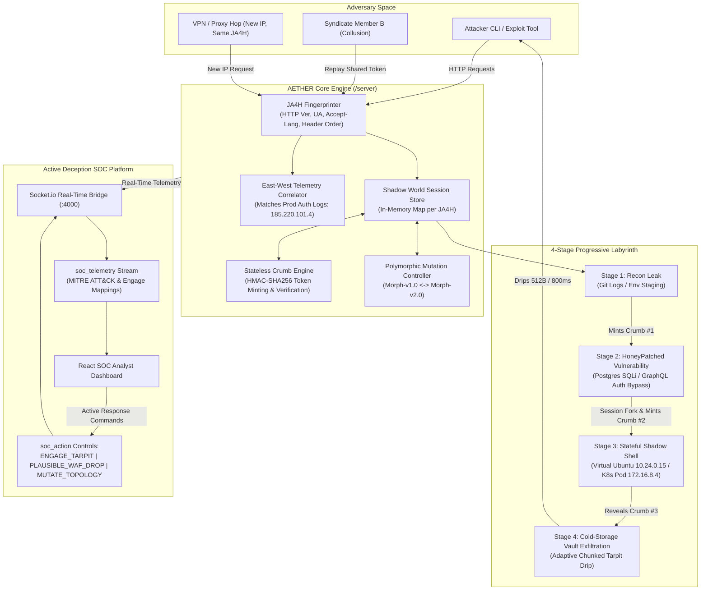

# AETHER-LABYRINTH Architecture

> **Ephemeral, Polymorphic 4-Stage Breadcrumb Honeypot & Active Deception SOC Platform**  
> *D3COY 1.0 — Problem Statement 04: Deception-Driven Threat Detection & Response*

---

## 1. Executive Summary & Deception Philosophy

Traditional honeypots fail in production because:
1. **Static Fingerprints**: Attackers quickly identify low-interaction decoys (synthetic banners, unreactive fake prompts, fixed ports).
2. **Brittle Killswitch Actions**: Abrupt TCP resets or explicit "Honeypot Detected" notices tip off sophisticated threat actors, prompting them to rotate IPs or shift targets.
3. **High Database Latency & Overhead**: Tracking stateful sessions and stolen tokens across distributed attackers introduces latency and database failure points during live incidents.

**AETHER-LABYRINTH** introduces an active, high-interaction deception platform built on three core pillars:
- **Earned Greed Progression**: Hackers are not handed root immediately; they must discover breadcrumbs, exploit realistic vulnerabilities (SQLi / GraphQL bypasses), pivot through jumpboxes, and attempt high-value exfiltration. Each step increases dwell time and intelligence fidelity.
- **Polymorphic Topology Mutation**: The decoy environment shifts dynamically between distinct enterprise topologies (`Morph-v1.0: Fintech-Git-SQLi` and `Morph-v2.0: Cloud-Env-GraphQL`). Replaying stale keys across mutations triggers deterministic Burned Token tripwires.
- **Stateless Self-Describing Breadcrumbs with JA4H Fingerprinting**: Tokens cryptographically bind the attacker's client fingerprint (`ja4h`), stage number, and topology seed via HMAC-SHA256. Threat actors sharing tokens (syndicates/lateral movement) or hopping VPNs are unmasked with zero database lookups.
- **Plausible Failure Exits**: When SOC analysts quarantine an adversary, the system never breaks character. Instead, it returns realistic HTTP 504 Gateway Timeouts styled identically to AWS WAF / Cloudflare Rate Limiters, leaving the attacker believing their network or tool faulted.

---

## 2. End-to-End System Architecture



---

## 3. The 4 Progressive "Earned Greed" Stages

| Stage | Name | Persona A (`Morph-v1.0`) | Persona B (`Morph-v2.0`) | Attack Objective | Honeytoken / Breadcrumb Minted | MITRE ATT&CK / ENGAGE |
|:---|:---|:---|:---|:---|:---|:---|
| **1** | **Recon Leak** | `GET /.git/logs/HEAD` | `GET /.env.staging` | Attacker discovers leaked staging endpoint & debug authorization headers | `Crumb #1` (`s: 1` signed token in comments/env) | **T1592** (Reconnaissance) / **EAC0001** (Lure Attacker) |
| **2** | **HoneyPatch Vuln** | `POST /api/internal/legacy-query` (Postgres SQLi) | `POST /v2/graphql-debug` (NoSQL / Auth Bypass) | Attacker injects payload; triggers HoneyPatch Session Fork leaking devops credentials | `Crumb #2` (`s: 2` ssh_auth_token in fake table dump) | **T1190** (Exploit Public-Facing App) / **EAC0005** (HoneyPatch Fork) |
| **3** | **Shadow Shell** | `POST /api/shell/exec` (`10.24.0.15` DevOps Jumpbox) | `POST /api/shell/exec` (`172.16.8.4` K8s Worker Pod) | Attacker runs Linux commands (`cat .bash_history`, `ps aux`, `ls -la`) inside in-memory virtual environment | `Crumb #3` (`s: 3` VAULT_MASTER_KEY in sync script / history) | **T1059.004** (Unix Shell Execution) / **EAC0012** (Synthetic Environment) |
| **4** | **Vault Exfil & Tarpit** | `GET /vault/v1/export` (Parquet Dump) | `GET /s3/v1/treasury-keys` (PEM Export) | Attacker exfiltrates confidential vault; system traps connection in a chunked adaptive rate-limited drip | Exfiltration captured; flags Critical Alert (Score 98) | **T1041** (Exfiltration Over C2) / **EAC0018** (Tarpit Containment) |

---

## 4. Core Architectural Engines

### 4.1. JA4H Client Fingerprinting (`/server/core/ja4h.js`)
Rather than relying solely on ephemeral IP addresses that attackers mask using Tor or proxies, AETHER computes a deterministic 16-character SHA-256 fingerprint (`ja4h`):
- Extracted elements:
  1. HTTP Protocol Version (`req.httpVersion`)
  2. Normalized User-Agent string
  3. Accept-Language header
  4. Header Key Ordering (preserving raw HTTP request order signature)
  5. Optional test override header `x-client-fingerprint` (for automated syndicate/machine switch demos)
- **Cross-IP Attribution**: When an attacker hops from `185.220.101.4` to `194.26.29.112` (VPN hop) while retaining their HTTP client tool, the `ja4h` matches identically. The system flags `ipChanged: true` while attributing all actions to the same persistent Shadow World.

### 4.2. Stateless HMAC-SHA256 Self-Describing Breadcrumbs (`/server/core/crumbCrypto.js`)
Honeytokens are completely self-describing and stateless, requiring **zero database queries**:
- **Token Format**: `vk_live_<base64url(payload)>.<10_char_signature>`
- **Payload Schema**:
  ```json
  {
    "s": 1,
    "f": "9f8e2b1c4a7d0031",
    "t": 1730386800000,
    "seed": "Morph-v1.0"
  }
  ```
- **Verification Logic**:
  1. **HMAC Signature Check**: Validates token authenticity against server secret.
  2. **Topology Mutation Check**: If `payload.seed !== currentSeedId`, flags `topologyMutated: true` (Burned Token Replay tripwire).
  3. **Collusion / Syndicate Check**: If `payload.f !== currentJa4h`, flags `tokenShared: true` (Syndicate member replay or tool shift).
  4. **Expiration**: Rejects tokens older than 900 seconds.

### 4.3. Polymorphic Mutation Engine (`/server/core/shadowWorld.js`)
The SOC analyst or automated defensive policy can trigger `MUTATE_TOPOLOGY`.
- Rotates active persona between `Morph-v1.0 (Fintech-Git-SQLi)` and `Morph-v2.0 (Cloud-Env-GraphQL)`.
- Updates the active seed ID.
- Automatically burns all previously issued breadcrumbs. Any subsequent attempt to use older tokens triggers an immediate high-priority alarm (`Burned Token Replay Attempt`).

### 4.4. Per-Attacker Shadow World Store
To prevent cross-contamination and eliminate external DB dependencies, sessions are stored in an in-memory `Map<ja4h, ShadowSession>`:
- Tracks:
  - `ja4h`, current IP, history of observed IPs
  - `threatScore` (0 to 100 progressive risk score)
  - `highestStage` reached (1 to 4)
  - `dwellTimeSeconds` (real-time elapsed dwell counter)
  - `virtualFiles` & `commandHistory` for Stage 3 Shell
  - `tarpitActive` and `tarpitSpeed`
  - `plausibleWafDrop` quarantine flag
- Pre-seeded **East-West Correlation**:
  - `prodAuthLogs` contains known attacker IP `185.220.101.4` (failed SSH attempts against production servers 8 minutes prior).
  - When an incoming connection originates from `185.220.101.4`, `prodCorrelated: true` is stamped on all telemetry, proving an active threat actor pivoting from perimeter scanning to decoy traps.

### 4.5. Adaptive Chunked Streaming Tarpit
When the attacker reaches Stage 4 and requests cold-storage vault keys:
- The server does not immediately disconnect. Instead, it enters a chunked transfer encoding stream (`Transfer-Encoding: chunked`).
- Drips 512 bytes of high-entropy synthetic encrypted payload every 800ms (`~0.6 KB/s`).
- Emits real-time `tarpit_progress` events over Socket.io so SOC analysts watch the attacker's exfiltration trickle in slow motion.
- SOC analysts can execute `ENGAGE_TARPIT` to drop the rate to 128 bytes every 2000ms (`~0.06 KB/s`), maximizing attacker dwell time while incident response investigates.

### 4.6. Plausible Failure Exit Middleware
When the SOC analyst clicks "Quarantine (Plausible 504 Exit)":
- The system flags `plausibleWafDrop = true` for that attacker's `ja4h` or IP.
- Ongoing chunked streams are gracefully truncated with an HTTP 504 Gateway Timeout.
- Subsequent requests receive a hyper-realistic AWS WAF / Cloudflare Rate-Limit HTML/JSON page (`Error 1015 / Rule #942100: Upstream Gateway Timeout`).
- The attacker assumes corporate infrastructure collapsed under load, preventing countermeasures or IP evasion.

---

## 5. SOC Telemetry & Real-Time Socket.io Contract

The server runs on **Port 4000** and emits `"soc_telemetry"` events to connected SOC dashboards:

```json
{
  "eventId": "evt_1730386800123_4a7d",
  "timestamp": "14:55:00.123",
  "stage": 1,
  "attacker": {
    "ip": "185.220.101.4",
    "ja4h": "9f8e2b1c4a7d0031",
    "ipChanged": false,
    "tokenShared": false,
    "topologyMutated": false,
    "prodCorrelated": true
  },
  "action": {
    "title": "Stage 1 Git Recon Probe Leaked",
    "endpoint": "/.git/logs/HEAD",
    "rawPayload": "GET /.git/logs/HEAD",
    "crumbMinted": "vk_live_eyJzIjoxLCJmIjoiOWY4Z...7a1bc",
    "crumbUsed": null
  },
  "mitre": {
    "attack": { "id": "T1592", "name": "Gather Victim Host Information" },
    "engage": { "id": "EAC0001", "name": "Lure Attacker" }
  },
  "metrics": {
    "threatScore": 25,
    "dwellTimeSeconds": 14,
    "polymorphicSeed": "Morph-v1.0 (Fintech-Git-SQLi)"
  }
}
```

### Inbound SOC Analyst Control Actions (`soc_action`):
- `ENGAGE_TARPIT`: Slows down active Stage 4 streaming tarpit to 128B / 2000ms.
- `PLAUSIBLE_WAF_DROP`: Quarantines attacker via HTTP 504 Cloudflare/AWS WAF plausible exit.
- `MUTATE_TOPOLOGY`: Hot-rotates persona (`Morph-v1.0` <-> `Morph-v2.0`), invalidating old breadcrumbs.
- `SIMULATE_STAGE`: Triggers synthetic stage test events (Stages 1-4, Syndicate replay, Burned token replay).

---

## 6. Attacker CLI Simulation Suite (`/attacker-cli/attack_demo.js`)

An interactive terminal tool designed for live pitch presentations:
```
========================================================================
             AETHER-LABYRINTH // ACTIVE DECEPTION DEMO CLI              
========================================================================
 Active Attacker IP:  185.220.101.4 (Correlated with East-West Prod Logs)
 Client JA4H Hash:    9f8e2b1c4a7d0031
 Current Topology:    Morph-v1.0 (Fintech-Git-SQLi)
 Stored Honeytokens:  Crumb #1: [None] | Crumb #2: [None] | Crumb #3: [None]
========================================================================

  [1] Run Stage 1: Recon Git Leak Scan (Harvest Crumb #1)
  [2] Run Stage 2: Exploit SQLi & Harvest SSH Honeytoken (Crumb #2)
  [3] Run Stage 3: Connect to DevOps Jumpbox & Snoop .bash_history (Crumb #3)
  [4] Run Stage 4: Exfiltrate Cold Vault using Stolen Key (Triggers Live Tarpit)
  [5] Simulate IP Switch / VPN Hop (Same JA4H, New IP -> Tests Cross-IP Attribution)
  [6] Simulate Hacker Syndicate Sharing (Pass Stolen Key to Hacker B / New JA4H -> Collusion Alert)
  [7] Replay Old Token After Polymorphic Mutation (Triggers Burned Token Tripwire)
  [8] Toggle Active Target Persona (Morph-v1.0 <-> Morph-v2.0)
  [0] Exit Demo
========================================================================
Select action [0-8]: 
```

---

## 7. Directory Structure

```
d3coy/
├── ARCHITECTURE.md                 # Complete System Architecture & Deception Philosophy
├── server/
│   ├── package.json                # Express, Socket.io, cors, chalk (or zero-dep)
│   ├── index.js                    # Server entrypoint on Port 4000 & Socket.io handler
│   ├── core/
│   │   ├── ja4h.js                 # 16-char deterministic JA4H client fingerprinting
│   │   ├── crumbCrypto.js          # Stateless HMAC-SHA256 self-describing breadcrumbs
│   │   └── shadowWorld.js          # In-memory Map session store, prod correlation & mutation
│   └── stages/
│       ├── trapRoutes.js           # Express router for Stages 1-4 & Plausible 504 WAF exits
│       └── virtualShell.js         # Realistic Ubuntu bash command execution engine
└── attacker-cli/
    ├── package.json                # Standalone CLI package
    └── attack_demo.js              # Interactive colorized terminal exploit suite
```
