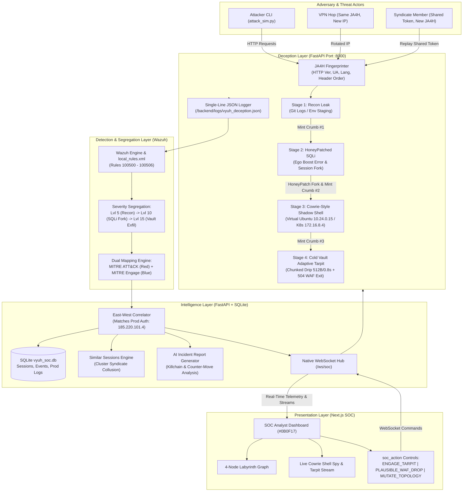

# VYUH (CHAKRAVYUH) — Architecture

> **Ephemeral, Polymorphic 4-Stage Active Deception Platform & Wazuh Segregation Engine**  
> *D3COY 1.0 — Problem Statement 04: Deception-Driven Threat Detection & Response*  
> **Standardized Stack**: FastAPI (Python 3.12, Port 8000) + Wazuh Detection Layer (Rules 100500-100506) + SQLite (`vyuh_soc.db`) + Next.js SOC Platform (Port 3000)

---

## 1. Executive Summary & The "Chakravyuh" Philosophy

In ancient tactical warfare, the **Chakravyuh (Vyuh)** was a multi-tiered, inward-spinning labyrinth: easy to enter, deceptively rewarding at outer perimeters, but progressively inescapable as the intruder advanced toward the center.

**VYUH** applies this active deception doctrine to modern enterprise cyber defense:
1. **Earned Greed Progression**: Adversaries are lured through 4 progressive decoy stages. Each stage confirms their biases, feeds their ego (verbose SQL syntax errors, dumped staging accounts), and baits them into high-dwell traps.
2. **Polymorphic Topology Mutation**: The decoy environment dynamically rotates between two distinct enterprise personas (`Morph-v1.0: Fintech-Git-SQLi` and `Morph-v2.0: Cloud-Env-GraphQL`). Replaying expired tokens after a mutation trips deterministic Burned Token alarms.
3. **Stateless HMAC-SHA256 Breadcrumbs with JA4H Fingerprinting**: Honeytokens cryptographically bind the attacker's client fingerprint (`ja4h`), trap stage number, and topology seed without database overhead. Attackers hopping VPNs retain attribution; syndicates sharing tokens trigger lateral collusion tripwires instantly.
4. **Wazuh Detection & Segregation**: Every deception event is logged to `/backend/logs/vyuh_deception.json` and decoded against custom Wazuh Rules (`100500 - 100506`). The system segregates automated scanning noise (Level 5) from active credential theft (Level 10) and catastrophic cold-vault exfiltration (Level 15 Critical).
5. **Plausible Failure Exits**: When SOC analysts quarantine an adversary, the platform never alerts the hacker with "Decoy Detected". Instead, it returns realistic HTTP 504 Gateway Timeouts styled as Cloudflare Rate Limits / AWS WAF rule terminations (`AWS-WAF-RULE-942100`), ensuring adversaries blame their own network tools.

---

## 2. End-to-End System Pipeline



---

## 3. The 4 Progressive Labyrinth Stages

| Stage | Name | Persona A (`Morph-v1.0`) | Persona B (`Morph-v2.0`) | Adversary Action | Honeytoken / Breadcrumb Minted | MITRE ATT&CK | MITRE Engage | Wazuh Rule |
|:---|:---|:---|:---|:---|:---|:---|:---|:---|
| **1** | **Recon Leak** | `GET /.git/logs/HEAD` | `GET /.env.staging` | Attacker probes repository reflogs or staging environment configs | `Crumb #1` (`s: 1`, signed HMAC token) | **T1592** (Reconnaissance) | **EAC0001** (Lure Attacker) | **Rule 100501** (Level 5) |
| **2** | **HoneyPatched SQLi** | `POST /api/internal/legacy-query` (PostgreSQL) | `POST /v2/graphql-debug` (NoSQL / Auth) | Attacker probes with single quote `'` (receives syntax error), then executes `' OR 1=1` (Session Fork) | `Crumb #2` (`s: 2`, `ssh_auth_token` in fake account dump) | **T1190** (Exploit Public-Facing App) | **EAC0005** (HoneyPatch Fork) | **Rule 100502** (Lvl 7) / **100503** (Lvl 10) |
| **3** | **Cowrie-Style Shadow Shell** | `POST /api/shell/exec` (`10.24.0.15` DevOps Jumpbox) | `POST /api/shell/exec` (`172.16.8.4` K8s Pod) | Attacker executes bash commands (`cat .bash_history`, `vault_sync.sh`, `ps aux`, `ls -la`) | `Crumb #3` (`s: 3`, `VAULT_MASTER_KEY` in sync script) | **T1059.004** (Unix Shell) | **EAC0012** (Synthetic Env) | **Rule 100504** (Level 12) |
| **4** | **Cold Vault Adaptive Tarpit** | `GET /vault/v1/export` (`parquet` dump) | `GET /s3/v1/treasury-keys` (`pem` dump) | Attacker initiates high-value financial data exfiltration with stolen key | Critical alert triggered; connection held in 512B/0.8s drip | **T1041** (Exfiltration Over C2) | **EAC0018** (Tarpit Containment) | **Rule 100505** (Level 15 Critical) |

---

## 4. Wazuh Rule Segregation Architecture (`/wazuh/local_rules.xml`)

VYUH incorporates custom Wazuh rule definitions (Rules `100500` through `100506`) to separate internet background scanning from active lateral breaches:

```xml
<group name="vyuh_deception,honeypot,">
  <!-- Rule 100500: Base Deception Event -->
  <rule id="100500" level="3">
    <decoded_as>json</decoded_as>
    <field name="vyuh_event">true</field>
    <description>VYUH Deception telemetry event captured</description>
  </rule>

  <!-- Rule 100501: Stage 1 Recon Leak -->
  <rule id="100501" level="5">
    <if_sid>100500</if_sid>
    <field name="stage">1</field>
    <description>Stage 1: Public Recon Probe &amp; Breadcrumb Discovery</description>
    <mitre>
      <id>T1592</id>
    </mitre>
  </rule>

  <!-- Rule 100502: Stage 2a SQLi Syntax Probe (Ego Boost) -->
  <rule id="100502" level="7">
    <if_sid>100500</if_sid>
    <field name="action.title">Stage 2 SQLi Syntax Error Triggered (Ego Boost)</field>
    <description>Stage 2a: Unescaped SQL Database Syntax Error Probe</description>
    <mitre>
      <id>T1190</id>
    </mitre>
  </rule>

  <!-- Rule 100503: Stage 2b HoneyPatch SQLi Session Fork -->
  <rule id="100503" level="10">
    <if_sid>100500</if_sid>
    <field name="stage">2</field>
    <field name="action.title">Stage 2 HoneyPatch Session Fork Triggered</field>
    <description>Stage 2b: HoneyPatch SQLi Exploit &amp; Session Fork Triggered</description>
    <mitre>
      <id>T1190</id>
    </mitre>
  </rule>

  <!-- Rule 100504: Stage 3 Cowrie-Style Shell Exec -->
  <rule id="100504" level="12">
    <if_sid>100500</if_sid>
    <field name="stage">3</field>
    <description>Stage 3: Interactive Virtual Shell Execution in Jumpbox</description>
    <mitre>
      <id>T1059.004</id>
    </mitre>
  </rule>

  <!-- Rule 100505: Stage 4 Vault Exfiltration Tarpit -->
  <rule id="100505" level="15">
    <if_sid>100500</if_sid>
    <field name="stage">4</field>
    <description>CRITICAL: Stage 4 Cold Vault Exfiltration &amp; Adaptive Tarpit Engaged</description>
    <mitre>
      <id>T1041</id>
    </mitre>
  </rule>

  <!-- Rule 100506: Syndicate Collusion & Burned Token Tripwire -->
  <rule id="100506" level="14">
    <if_sid>100500</if_sid>
    <match>tokenShared: true|topologyMutated: true</match>
    <description>HIGH: Cross-Client Token Sharing (Syndicate Collusion) or Burned Token Replay</description>
    <mitre>
      <id>T1078</id>
    </mitre>
  </rule>
</group>
```

---

## 5. Intelligence Layer & SQLite Architecture (`vyuh_soc.db`)

The backend stores persistent state in `/backend/data/vyuh_soc.db`:
- **`prod_auth_logs`**: Pre-seeded with real production incident telemetry (`185.220.101.4` attempting failed SSH logins against `real-prod-db-01` 8 minutes ago). When the adversary pivots into the honeypot, `prod_correlated: true` triggers an East-West correlation alert.
- **`attacker_sessions`**: Tracks per-JA4H session state, observed IPs, threat score (0-100), dwell time, quarantined status (`plausible_waf_drop`), and active tarpit parameters.
- **`telemetry_events`**: Full historical archive of all Wazuh-decoded and dual-MITRE mapped events.
- **`command_history`**: Records every keystroke executed in Stage 3 virtual shell.
- **`similar_sessions`**: Groups sessions across distinct IPs exhibiting identical JA4H client fingerprints or shared honeytokens (Syndicate Clustering).

---

## 6. Directory Layout

```
d3coy/
├── ARCHITECTURE.md                 # VYUH Architecture, Chakravyuh Doctrine & Wazuh Spec
├── backend/
│   ├── app/
│   │   ├── main.py                 # FastAPI application, CORS, routers & startup banner
│   │   ├── core/
│   │   │   ├── ja4h.py             # 16-char deterministic JA4H client fingerprinter
│   │   │   ├── crumb_crypto.py     # Stateless HMAC-SHA256 honeytoken engine
│   │   │   ├── shadow_world.py     # Per-attacker shadow sessions & polymorphic topologies
│   │   │   ├── wazuh_bridge.py     # JSON file logging & dual-mode Wazuh rule evaluator
│   │   │   └── intelligence.py     # SQLite persistence, similar sessions & LLM reports
│   │   └── stages/
│   │       ├── routes.py           # Trap stages 1-4 & Plausible 504 WAF exit middleware
│   │       └── virtual_shell.py    # Cowrie-style Ubuntu bash execution engine
│   ├── logs/
│   │   └── vyuh_deception.json     # Single-line JSON log stream ingested by Wazuh
│   ├── data/
│   │   └── vyuh_soc.db             # Zero-dependency local SQLite database
│   └── requirements.txt            # Python dependencies (fastapi, uvicorn, websockets, requests)
├── wazuh/
│   └── local_rules.xml             # Custom Wazuh detection rules (IDs 100500-100506)
├── attacker-cli/
│   └── attack_sim.py               # Interactive colorized Python attacker simulation script
└── frontend/                       # Next.js SOC Dashboard (Port 3000)
```
